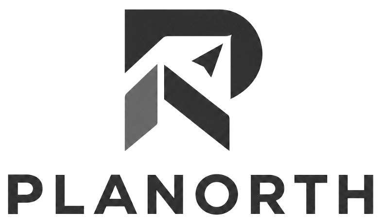
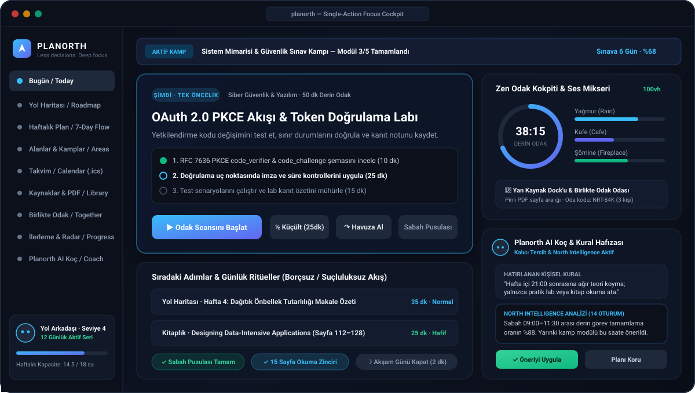
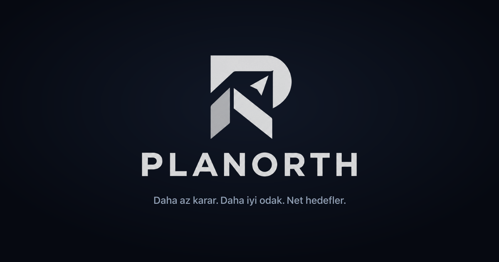
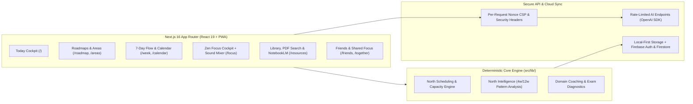

<div align="center">

<picture>
  <source media="(prefers-color-scheme: dark)" srcset="./public/planorth-full-white.png">
  <source media="(prefers-color-scheme: light)" srcset="./public/planorth-full-dark.png">
  
</picture>

### **Less Decisions. Deeper Focus. Zero Guilt.**
### **Daha Az Karar. Daha Derin Odak. Sıfır Suçluluk.**

[](https://github.com/frknian/north/actions/workflows/ci.yml)
[](https://nextjs.org/)
[](https://react.dev/)
[](https://www.typescriptlang.org/)
[](https://firebase.google.com/)
[](https://tailwindcss.com/)

<p align="center">
  <a href="#-english"><strong>🇬🇧 English Documentation</strong></a> ·
  <a href="#-türkçe"><strong>🇹🇷 Türkçe Dokümantasyon</strong></a> ·
  <a href="./docs/KULLANMA-KILAVUZU.md"><strong>📖 Kullanım Kılavuzu / User Guide</strong></a>
</p>



</div>

---

# 🇬🇧 English

## Overview

**Planorth** is an evidence-based personal focus, learning roadmap, and AI coaching platform designed to eliminate **decision fatigue, tutorial hell, procrastination, and backlog guilt**.

Unlike traditional to-do lists that overwhelm you with dozens of overdue items, Planorth surfaces **a single meaningful next action (`NOW`)**, adapts to your real weekly capacity and fixed calendar blocks, protects your focus in a distraction-free **100vh Zen Focus Cockpit**, and tracks verified outputs rather than vanity metrics.

<p align="center">
  
</p>

---

## Core Philosophy

1. **Single Meaningful Priority (`Single Big Action`)** — Instead of paralyzing you with 20 competing tasks, the **Today** cockpit selects one primary focus card at a time based on deadlines, roadmap schedule, area priority, and energy level.
2. **No-Debt, Guilt-Free Flow (`Shrink · Postpone · Pool`)** — Missed tasks never pile up into red penalty debt. With one click, cut a task in half (`Shrink`), move it to another day (`Postpone`), or return it to the flexible weekly pool (`Pool`).
3. **Personal Workspace Sovereignty** — Your pinned page ranges, reading lists, and notes belong strictly to you. AI never injects unsolicited clutter or mutates your schedule without your explicit confirmation.
4. **Evidence-Based Progression** — Progress is measured through real focus minutes, completed roadmap records, practical labs, reading page logs, adaptive level tests, and sealed weekly retrospectives.

---

## Key Features

| Module | Highlights |
| :--- | :--- |
| **🧭 Today Cockpit (`/`)** | Zero-scroll desktop control tower featuring the **NOW** focus card, 2-minute **Morning Compass** & **Evening Wrap-up** rituals, active Topic Sprint countdown bar, and daily micro-habits. |
| **🗺️ Learning Roadmaps (`/roadmap`)** | Generate up to 26-week structured plans with Planorth AI Coach, import via **JSON / CSV / Markdown / plain text**, or use the one-click **ChatGPT / Gemini** prompt-paste workflow. |
| **🎯 Areas & Topic Sprints (`/areas`)** | Manage multi-domain goals (Cybersecurity, Software Engineering, Languages, Medicine, Math, Exams). Upload PDFs or lecture notes to auto-split into dated **Topic Sprints**. |
| **📅 7-Day Flexible Flow & Calendar (`/week`, `/calendar`)** | Visual 7-day board with customizable rest days, smart auto-distribution (`Weekdays only`, `Weekends only`, or `Custom days`), fixed time-block protection, and `.ics` calendar export. |
| **🧘 Zen Focus Cockpit (`/focus`)** | Full-screen distraction-free timer with pause/recovery, Picture-in-Picture support, a **6-channel Ambient Sound Mixer** (*Rain, Storm, Cafe, Fireplace, Ocean, White Noise*), and an integrated side **Resource Dock**. |
| **📚 Research & Library Hub (`/resources`)** | 4-tab research studio: Personal Book Library with page tracking, in-app **Google PDF & Web Search**, private **Pinned Page Ranges & Lightbox**, and one-click **Google NotebookLM** bundle export. |
| **🎓 Exam Calendar & Adaptive Level Test** | Multi-phase exam runway generator that allocates extra time to weak subjects based on mock exam scores, plus a 12-question **Adaptive Level Test** that dynamically adjusts difficulty. |
| **🤝 Friends & Shared Focus Rooms (`/friends`, `/together`)** | Opt-in friend invites, weekly consistency leaderboards, and real-time synchronized **Shared Focus Rooms** (25 / 50 / 90 min) via 6-character invite codes. |
| **🤖 Planorth AI Coach & North Intelligence (`/coach`)** | Domain-aware AI Coach with **Persistent Rule Memory** (remembers your personal scheduling constraints) backed by **North Intelligence** deterministic 4- and 12-week behavioral pattern analysis. |
| **🛡️ Portfolio, Labs & Certifications (`/evidence`, `/labs`, `/certifications`)** | Log hands-on troubleshooting labs, independent solve rates, GitHub repositories, technical reports, and certification milestones. |

---

## System Architecture



---

## Tech Stack

- **Framework:** [Next.js 16.3](https://nextjs.org/) (App Router, Turbopack / Webpack, Server & Client Components)
- **UI & Styling:** [React 19.2](https://react.dev/), [Tailwind CSS v4](https://tailwindcss.com/), [Radix UI](https://www.radix-ui.com/), [shadcn/ui](https://ui.shadcn.com/), [Lucide Icons](https://lucide.dev/)
- **AI & Streaming:** [Vercel AI SDK (`ai` v7)](https://sdk.vercel.ai/), `@ai-sdk/openai`, [Streamdown](https://github.com/vercel/streamdown) (Code, Math, Mermaid, CJK rendering), [Zod v4](https://zod.dev/)
- **Authentication & Cloud Database:** [Firebase Auth](https://firebase.google.com/docs/auth) (Email/Password & Google OAuth) + [Cloud Firestore](https://firebase.google.com/docs/firestore) with strict per-user security rules (`firestore.rules`) and offline-first `localStorage` fallback
- **Security & Observability:** Per-request cryptographic `nonce` Content Security Policy (`src/proxy.ts`), strict origin/token verification, bounded JSON stream reader, optional Upstash Redis rate limiting, and webhook error/feedback reporting
- **Testing:** Node.js native test runner + standalone simulation suites (Persona, 52-Week Progression, Multi-Device Ergonomics, Security Regression) + [Playwright](https://playwright.dev/) E2E tests

---

## Quick Start (English)

### 1. Clone & Install

```bash
git clone https://github.com/frknian/north.git
cd north
npm install
```

### 2. Environment Configuration

Copy `.env.example` to `.env.local`:

```bash
cp .env.example .env.local
```

> [!NOTE]
> **Local-First Mode:** Planorth runs out of the box **without** Firebase credentials—all workspace state is persisted locally in your browser (`localStorage`). Configure Firebase and `OPENAI_API_KEY` when you want cross-device cloud sync, shared focus rooms, and AI coaching.

```env
# Firebase Client Configuration (Cross-device sync, Auth, Friends & Together rooms)
NEXT_PUBLIC_FIREBASE_API_KEY=
NEXT_PUBLIC_FIREBASE_AUTH_DOMAIN=
NEXT_PUBLIC_FIREBASE_PROJECT_ID=
NEXT_PUBLIC_FIREBASE_STORAGE_BUCKET=
NEXT_PUBLIC_FIREBASE_MESSAGING_SENDER_ID=
NEXT_PUBLIC_FIREBASE_APP_ID=

# OpenAI Configuration (Planorth AI Coach, Roadmap Generator, Level Test)
OPENAI_API_KEY=
OPENAI_MODEL=gpt-5.6-luna

# Public site URL (used for sitemap, canonical links, OpenGraph)
NEXT_PUBLIC_APP_URL=http://localhost:3000

# Optional: Shared serverless rate limiting (Upstash Redis REST)
UPSTASH_REDIS_REST_URL=
UPSTASH_REDIS_REST_TOKEN=

# Optional: Incoming webhooks for client/server errors and user support feedback
ERROR_WEBHOOK_URL=
FEEDBACK_WEBHOOK_URL=
```

### 3. Run Development Server

```bash
npm run dev
```

Open [http://localhost:3000](http://localhost:3000) in your browser.

### 4. Quality & Test Commands

```bash
npm run typecheck   # TypeScript strict type verification
npm run lint        # ESLint static analysis
npm test            # Unit, domain engine, security & 52-week persona simulations
npm run build       # Production Next.js build
npm run test:e2e    # Playwright end-to-end smoke suite
```

---

<br />

# 🇹🇷 Türkçe

<div align="center">
  
  <h3><strong>Planorth — Kişisel Odak, Yol Haritası ve Yapay Zekâ Koçluk Sistemi</strong></h3>
</div>

## Proje Hakkında

**Planorth**, klasik yapılacaklar listelerinin (to-do list) yol açtığı **karar yorgunluğunu, ertelemeciliği, kaynak karmaşasını ve biriken görev suçluluğunu** ortadan kaldırmak için geliştirilmiş kanıta dayalı bir kişisel odak ve gelişim platformudur.

Yüzlerce maddelik görev listeleri arasında kaybolmak yerine Planorth; hedeflerinizi haftalık yol haritalarına dönüştürür, her gün size yalnızca **sıradaki en anlamlı tek adımı (`ŞİMDİ`)** sunar, gerçek çalışma kapasitenizi korur ve gelişiminizi somut çıktılarla ölçer.

---

## Temel Sistem Felsefesi

1. **Tek Anlamlı Öncelik Kuralı (`Single Big Action`):**
   Aynı anda 10 farklı görevle uğraşmak zihni felç eder. Planorth, teslim tarihlerinize, yol haritanıza ve enerjinize göre her an yalnızca üzerinde çalışmanız gereken **tek bir ana odak kartını** öne çıkarır.
2. **Borçsuz ve Suçluluksuz Akış (`Küçült · Ertele · Havuza Al`):**
   Hayatın getirdiği aksaklıklar doğaldır. Yetişmeyen işler "kırmızı ceza puanlarına" dönüşmez; tek tıkla yarıya indirilir (`Küçült`), başka güne kaydırılır (`Ertele`) veya esnek haftalık havuza (`Havuza Al`) bırakılır.
3. **Kişisel Alan Dokunulmazlığı:**
   Pinlediğiniz sayfa aralıkları, okuma listeleriniz ve kişisel yol haritanız tamamen size aittir. Yapay zekâ siz talep etmeden listenize izinsiz içerik enjekte etmez; tüm plan değişiklikleri onayınızla uygulanır.
4. **Kanıta Dayalı Gelişim:**
   İlerleme süslü yüzdelerle değil; tamamlanan gerçek odak dakikaları, çözülen pratik lablar, okunan kitap sayfaları, seviye testleri ve pazar retrospektifleriyle ölçülür.

---

## Öne Çıkan Özellikler

### 1. Bugün Kokpiti (`/`)
- **Büyük "ŞİMDİ" Odak Kartı:** Görevin mikro adımlarını gösterir; tek tıkla Odak Kokpiti'ni başlatır veya görevi yarıya bölüp ertelemenize olanak tanır.
- **Sabah Pusulası & Günü Kapat Ritüelleri (2 dk):** Güne niyet belirleyerek başlama ve akşam suçluluk duymadan günü mühürleme akışı.
- **Aktif Kamp Şeridi & Mikro Alışkanlıklar:** Devam eden sınav/konu kampınız için canlı geri sayım ve günlük alışkanlık zincirleri.

### 2. Yol Haritası & AI Koç ile Plan Oluşturma (`/roadmap`)
- **Planorth Koç ile Oluşturma:** Hedefinizi, seviyenizi, haftalık ayırabileceğiniz saati ve hedef tarihinizi girerek 26 haftaya kadar kişisel yol haritası üretin.
- **Çoklu İçe Aktarma:** JSON, CSV, Markdown veya düz metin dosyalarını yükleyin; PDF/Word ders içeriklerini yapıştırıp koça düzenletin.
- **ChatGPT / Gemini Entegrasyonu:** Hesap bağlamaya gerek kalmadan hazır istemi (prompt) kopyalayın ve çıktıyı doğrudan Planorth'a yapıştırarak etkileşimli plana dönüştürün.

### 3. Alanlar, Alt Konu Kampları ve Sınav Takvimi (`/areas`)
- **Çoklu Alan Yönetimi:** Siber Güvenlik, Yazılım, Yabancı Dil, Tıp, Matematik, YKS/KPSS gibi her alan için ayrı seviye (1–10), hedef ve özel metrik takibi.
- **Alt Konu / Sınav Kampı (Topic Sprint):** PDF ders notunuzu veya slaytınızı yükleyin; sistem konuyu modüllere bölsün ve sınav tarihine kadar takviminize yerleştirsin.
- **Sınav Takvimi & Uyarlanabilir Seviye Testi:** Deneme netlerinize göre zayıf derslere daha fazla ağırlık veren aşamalı sınav planlayıcı ve zorluğu performansınıza göre değişen 12 soruluk **Seviye Testi**.

### 4. Haftalık 7 Günlük Akış ve Takvim (`/week`, `/calendar`)
- **Akıllı Otomatik Dağıtım:** Havuzdaki görevleri takviminizdeki boşluklara *Yalnızca Hafta İçi*, *Yalnızca Hafta Sonu* veya *Özel Günler* filtreleriyle dengeli dağıtın.
- **Kapasite & Çakışma Koruması:** İş, okul veya nöbet gibi sabit zaman bloklarınızın olduğu saatlere aşırı yükleme yapılmasını engeller.
- **`.ics` Takvim Dışa Aktarma:** Planlanan görev ve etkinlikleri Apple, Google veya Outlook takviminize aktarın.

### 5. Zen Odak Kokpiti & Ortam Ses Mikseri (`/focus`)
- **100vh Dikkat Korumalı Kokpit:** Tam ekran sayaç, sekme yenilemesinde oturum kurtarma, Picture-in-Picture (PiP) mini sayaç ve nefes egzersizi.
- **6 Kanallı Ortam Ses Mikseri:** *Yağmur, Fırtına, Kafe, Şömine, Okyanus Dalgası ve Beyaz Gürültü* katmanlarını bağımsız ses seviyeleriyle karıştırın.
- **Entegre Yan Kaynak Dock'u:** Sekmeler arasında kaybolmadan PDF sayfa aralıklarınızı, notlarınızı ve bağlantılarınızı odak ekranının yan panelinde açın.

### 6. Kaynaklar, Google PDF Arama & NotebookLM (`/resources`)
- **Kişisel Kitaplık:** Okuduğunuz kitapları, mevcut sayfanızı ve okuma yüzdelerinizi takip edin.
- **Sistem İçi Google PDF & Web Arama:** Reklam veya harici sekme karmaşası olmadan güvenilir açık PDF kaynaklarını ve teknik makaleleri doğrudan arayüzde sorgulayın.
- **Pinli Sayfa Aralıkları & Görsel Lightbox:** Çalışacağınız sayfa aralıklarını ve ders notu görsellerini kendi kişisel masanıza sabitleyin.
- **Google NotebookLM Paketi:** Seçtiğiniz kaynakları ve özetleri tek tıkla Markdown paketi olarak kopyalayıp NotebookLM'e aktarın.

### 7. Arkadaşlar & Birlikte Odak (`/friends`, `/together`)
- **Arkadaş Sistemi:** Davet koduyla arkadaş ekleyin; isteğe bağlı haftalık odak sıralamasını ve seri istatistiklerini paylaşın.
- **Birlikte Odak Odaları:** 25, 50 veya 90 dakikalık ortak çalışma odası kurun, 6 haneli oda kodunu paylaşın ve arkadaşlarınızla aynı sayaçta eşzamanlı odaklanın.

### 8. Planorth AI Koç & North Intelligence (`/coach`, `/progress`)
- **Kalıcı Kural Hafızası:** Koça söylediğiniz kişisel kurallar (*"Gece 21:00 sonrasına ağır teori koyma, pratik lab ver"*) kalıcı olarak hatırlanır.
- **North Intelligence:** Cihazınızı veya kameranızı izlemeden, yalnızca son 4 ve 12 haftalık odak kayıtlarınızdan en verimli saatlerinizi ve gerçek kapasitenizi hesaplayan deterministik analiz motoru.
- **5 Eksenli Radar & Büyüyen Yol Arkadaşı:** Tutarlılık, Derin Odak, Pratik Çıktı, Çeşitlilik ve Plan Disiplini analizleri ile odaklandıkça büyüyen sanal Yol Arkadaşı.

---

## Kurulum ve Çalıştırma (Türkçe)

### 1. Depoyu Klonlayın ve Bağımlılıkları Yükleyin

```bash
git clone https://github.com/frknian/north.git
cd north
npm install
```

### 2. Ortam Değişkenlerini Yapılandırın

`.env.example` dosyasını `.env.local` olarak kopyalayın:

```bash
cp .env.example .env.local
```

> [!TIP]
> **Yerel Mod Desteği:** Firebase veya OpenAI anahtarları tanımlanmadan da uygulama **Yerel Modda (`localStorage`)** eksiksiz çalışır. Cihazlar arası bulut eşitleme, Birlikte Odak odaları ve AI Koç özellikleri için aşağıdaki değişkenleri doldurabilirsiniz:

1. [Firebase Console](https://console.firebase.google.com) üzerinden bir proje oluşturun.
2. **Authentication → Sign-in method** altından **Email/Password** ve **Google** sağlayıcılarını etkinleştirin.
3. **Firestore Database** oluşturun ve depodaki [`firestore.rules`](./firestore.rules) dosyasının içeriğini Firestore Rules sekmesine yapıştırarak yayınlayın.
4. `.env.local` dosyanıza Firebase ve OpenAI bilgilerinizi ekleyin.

### 3. Geliştirme Sunucusunu Başlatın

```bash
npm run dev
```

Tarayıcınızda [http://localhost:3000](http://localhost:3000) adresini açın.

---

## Proje Dizin Yapısı / Project Structure

```text
planorth/
├── .github/workflows/ci.yml   # GitHub Actions CI (typecheck, lint, unit/sim tests, build, Playwright E2E)
├── docs/
│   ├── KULLANMA-KILAVUZU.md   # Kapsamlı Türkçe sistem ve iş akışı kılavuzu
│   ├── NORTH-FOCUS-SYSTEM.md  # Odak sistemi mimari sınırları ve tasarım ilkeleri
│   └── NORTH-INTELLIGENCE.md  # Deterministik davranış ve kapasite analizi dokümanı
├── e2e/
│   └── smoke.spec.ts          # Playwright uçtan uca (E2E) doğrulama testleri
├── public/                    # Marka görselleri, PWA ikonları, Service Worker ve önizleme grafikleri
├── src/
│   ├── app/                   # Next.js 16 App Router sayfaları ve güvenli API uç noktaları (/api/ai/*)
│   ├── components/
│   │   ├── ai-elements/       # Akış (streaming) mesaj ve konuşma bileşenleri
│   │   ├── features/          # Çalışma alanı sağlayıcısı, kaynak merkezi, ortak odak, hatırlatıcılar
│   │   ├── layout/            # Uygulama çerçevesi, kenar çubuğu, tema ve bildirim sistemi
│   │   ├── north/             # Bugün, Haftalık Plan, Takvim, Odak Kokpiti, Alanlar, Yol Haritası, İlerleme
│   │   └── ui/                # Radix UI & Tailwind tabanlı temel arayüz bileşenleri
│   ├── lib/                   # Deterministik çekirdek motorlar (north, intelligence, roadmap, coaching, firebase)
│   └── proxy.ts               # İstek başına kriptografik Nonce CSP üretimi
├── tests/                     # Birim testleri, 52 haftalık ilerleme, cihaz ergonomisi ve güvenlik testleri
└── firestore.rules            # Kullanıcı izolasyonlu, boyut korumalı Cloud Firestore güvenlik kuralları
```

---

## Güvenlik ve Gizlilik / Security & Privacy

- **İstek Başına Nonce Tabanlı CSP (`src/proxy.ts`):** Her HTTP yanıtında dinamik kriptografik `nonce` üretilir; `Strict-Transport-Security`, `X-Frame-Options: DENY`, `X-Content-Type-Options: nosniff` ve `Permissions-Policy` başlıkları zorunlu kılınır.
- **Sıkı API Koruması (`src/lib/server/api-security.ts`):** Tüm `/api/ai/*` uç noktaları Origin doğrulaması, Firebase ID Token kontrolü, boyut sınırlı JSON akış okuyucusu (`readLimitedJson`) ve hız sınırlaması (rate limiting) ile korunur.
- **Veri Sahipliği ve KVKK Uyumu:** Kullanıcılar tüm çalışma verilerini tek tıkla JSON olarak dışa aktarabilir, yedekten geri yükleyebilir veya `/account-reset` üzerinden bulut ve yerel verilerini kalıcı olarak silebilir.
- **Prompt Injection Sınırı (`src/lib/ai/model.ts`):** Kullanıcı girdileri sistem talimatlarından izole edilir ve AI çıktıları Zod şemalarıyla doğrulanmadan çalışma alanına uygulanmaz.
